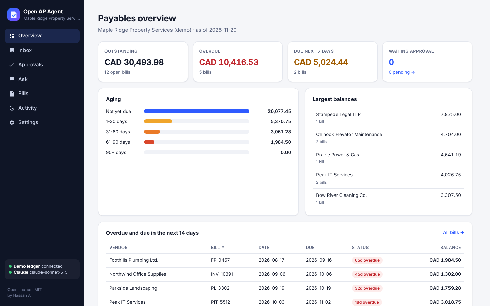
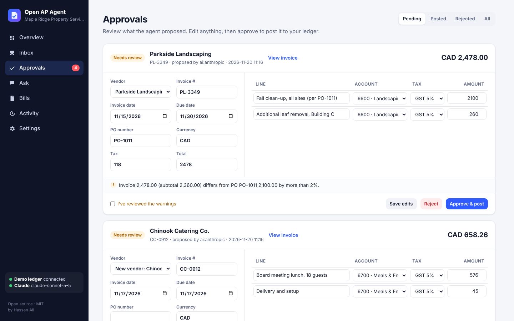
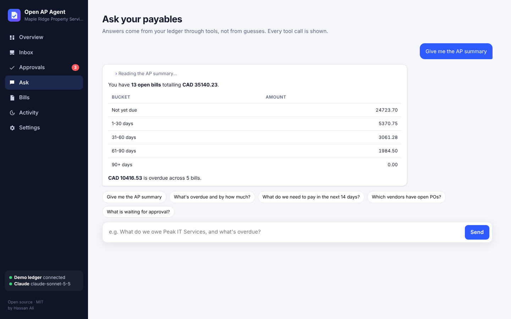

# Open AP Agent

**An open-source AI accounts payable agent you run yourself.** Bring your own Claude or OpenAI API key, connect QuickBooks Online or Xero, and let the agent read invoices, code them to the right GL account, run the AP controls and queue the bills for approval. A person approves every bill before it is posted.

It also answers questions about your payables, such as "what's overdue?", "what do we owe Peak IT?" or "what's due in the next 14 days?", using live figures from your ledger. And it works as a **connector for Claude and ChatGPT**, so you can do all of this from the AI app you already use.

By **Hassan Ali**. MIT licence. No dependencies: Node.js 20+ and nothing else.



## What it does

| | |
|---|---|
| **Reads invoices** | PDFs and photos (PNG, JPG, WEBP). Extracts the vendor, invoice number, dates, terms, PO number, lines, subtotal, tax and total. |
| **Codes them** | Matches the vendor in your ledger and picks an expense account (and tax code) for each line from your own chart of accounts. |
| **Runs the controls** | Duplicate detection (same vendor + invoice number, formatting-insensitive; same file; same amount within 10 days), arithmetic (lines → subtotal → tax → total), tax rate sanity check, PO match with tolerance, due-date and invoice-date checks, new-vendor flag, currency mismatch. |
| **Keeps people in charge** | Every bill lands in **Approvals**. Reviewers can edit any field, and the checks re-run automatically. Blocking issues can't be approved; warnings must be acknowledged. The checks run again right before posting. |
| **Posts to your ledger** | QuickBooks Online (Bill) or Xero (ACCPAY invoice), with the invoice file attached. New vendors are created on approval. |
| **Answers AP questions** | Aging, overdue, due soon, balances by vendor, open POs and the approval queue, always from tools and never guessed. |
| **Keeps an audit trail** | Who proposed, edited, approved, rejected or posted what, and when. AI actions are labelled (`ai:anthropic`, `mcp:…`). |



## Quick start

```bash
git clone https://github.com/hassanaliarshad110/open-ap-agent.git
cd open-ap-agent
npm start
```

Open http://localhost:8787 and go to **Settings**:

1. **AI model:** paste an [Anthropic](https://console.anthropic.com/settings/keys) or [OpenAI](https://platform.openai.com/api-keys) API key. Usage is billed by the provider to your own account.
2. **Accounting system:** start with the **demo ledger**, a fictional company with vendors, bills and POs, so you can try everything safely.
3. Go to **Inbox** and click a sample invoice. Five are included, each exercising a different control: a clean bill, a PO match, a duplicate, a new vendor with a wrong tax amount, and a photo of an invoice that runs over its PO.

Prefer config files? Copy `.env.example` to `.env`. Values in `.env` or environment variables take priority over the Settings screen.

## Connect QuickBooks Online

1. Create an app at [developer.intuit.com](https://developer.intuit.com) (QuickBooks Online and Payments → Accounting scope). It comes with a free sandbox company.
2. Add the redirect URI shown in Settings (default `http://localhost:8787/oauth/qbo/callback`).
3. Paste the client ID and secret in Settings, then click **Connect QuickBooks**.

Notes:
- Uses API minor version 75.
- US companies usually don't use tax codes on bills. The tax on the invoice is recorded as its own line, so the bill total matches the invoice.
- For Canada, the UK and other regions, set a default tax code id, or let the agent choose tax codes per line.

## Connect Xero

1. Create a **Web app** at [developer.xero.com/app/manage](https://developer.xero.com/app/manage). Use the Xero Demo Company to test.
2. Add the redirect URI shown in Settings (default `http://localhost:8787/oauth/xero/callback`).
3. Paste the client ID and secret, then click **Connect Xero**.

Notes:
- The app requests Xero's **granular scopes**, which apps created since March 2026 must use: `accounting.invoices accounting.contacts accounting.settings.read accounting.attachments`.
- Approved bills go to Xero as *Awaiting payment* (AUTHORISED), or as *Draft* if you prefer to approve them in Xero too.

## Use it from Claude or ChatGPT (MCP connector)

The same AP tools are exposed as an MCP server. The AI app reads the invoice in its own chat, then calls `search_vendors` → `list_accounts` → `check_invoice` → `propose_bill`. Bills still wait in Approvals.

Each method needs something different:
- **Claude.ai or ChatGPT:** these need an HTTPS address they can reach.
  1. Deploy the app, or run a tunnel such as `cloudflared tunnel --url http://localhost:8787`.
  2. Set `PUBLIC_URL`.
  3. Add the connector URL from Settings (`…/mcp/<secret>`) as a custom connector. Authentication: none, because the secret is in the URL.
- **Claude Desktop:** this runs fully on your computer. Add it to `claude_desktop_config.json`:
  ```json
  { "mcpServers": { "open-ap-agent": { "command": "node", "args": ["/full/path/to/open-ap-agent/src/mcp-stdio.js"] } } }
  ```
- **Claude Code:** run `claude mcp add open-ap-agent -- node /full/path/to/open-ap-agent/src/mcp-stdio.js`.

Tools: `ap_summary`, `list_bills`, `search_vendors`, `list_accounts`, `list_purchase_orders`, `check_invoice`, `propose_bill`, `approval_queue`. A further tool, `approve_and_post`, appears only if you switch on *Let connected AI apps post bills themselves*. It is off by default.



## Security and data

- Everything runs on your machine or your server. API keys, OAuth tokens, uploaded invoices, the approval queue and the audit log are stored in `data/` (git-ignored, files created with `0600` permissions).
- Data goes only to the provider it belongs to:
  - invoice files and questions → your chosen AI provider
  - ledger calls → Intuit or Xero
- The web app listens on `127.0.0.1` by default. If you expose it (`HOST=0.0.0.0` or behind a proxy), set `APP_PASSWORD`. The connector URL contains a random secret: treat it like a password.
- The AI can't post anything unless you turn that on. Even then, the checks run first, and blocked bills can't be posted.
- OAuth uses a one-time `state` parameter, and tokens refresh automatically.

## Run the tests

```bash
npm test
```

27 offline tests cover:
- the AP controls
- the full upload → AI → approval → posting flow against mock Claude and OpenAI APIs (PDF and image input, tool calling)
- the QuickBooks and Xero connectors against mock APIs (OAuth exchange and refresh, queries, bill payloads, attachments)
- the MCP server over HTTP and stdio

## Project layout

```
src/server.js         web server, REST API, OAuth callbacks, MCP endpoint
src/agent.js          the AI loop (Claude or OpenAI) with tool calling
src/tools.js          the AP tools shared by the chat and the connector
src/checks.js         AP controls
src/ap.js             summary, aging, approval queue, posting
src/ledger/           demo.js, qbo.js, xero.js
src/llm/              anthropic.js, openai.js
src/mcp.js            MCP server (JSON-RPC), mcp-stdio.js for local clients
public/               the web app (plain HTML/CSS/JS, no build step)
samples/              fictional sample invoices
```

## Roadmap ideas

- Credit notes
- Bill payments and payment runs
- Email inbox ingestion
- Multi-company support
- Approval limits by amount
- Sage and NetSuite connectors

Contributions welcome.

## Disclaimer

This software helps with bookkeeping work but does not replace professional judgment. Review what it proposes. It is provided as-is under the MIT licence, with no warranty.
